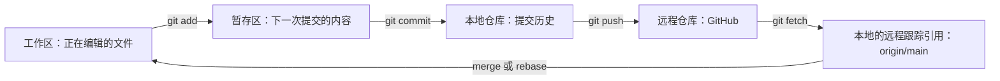

# Git 与 GitHub 入门：核心概念、上传流程与协作实践

这个仓库用于练习 Git 版本管理和 GitHub 远程协作，记录从本地文件提交、推送，到分支开发和 Pull Request 的完整流程。

- `readme.md`：学习笔记与操作指南。
- `a.txt`：用于练习修改、暂存、提交和查看差异的示例文件。

学习参考：技术爬爬虾的 [《Git+Github核心概念大串讲，从零到一全攻略，详细实战教程》](https://www.bilibili.com/video/BV1ySLc6QEcB/)。
本文按视频公开简介与章节组织知识点，并补充官方文档中的命令说明和排错方法；不是视频的逐字转录。

> Windows 示例使用 PowerShell；Git 命令也适用于 Git Bash、Linux 和 macOS。示例中的用户名、邮箱、仓库地址和提交 ID 需要替换成自己的实际值。

## 一、学习路线与视频定位

| 视频位置 | 学习主题 | 本文对应内容 |
| --- | --- | --- |
| [00:50](https://www.bilibili.com/video/BV1ySLc6QEcB/?t=50) | Git 与 GitHub 是什么 | 工具与平台的区别 |
| [03:57](https://www.bilibili.com/video/BV1ySLc6QEcB/?t=237) | 实战准备 | 安装、身份配置、认证 |
| [08:29](https://www.bilibili.com/video/BV1ySLc6QEcB/?t=509) | Commit 提交 | 快照、历史与差异 |
| [14:18](https://www.bilibili.com/video/BV1ySLc6QEcB/?t=858) | Branch 分支 | 创建、切换与合并 |
| [17:50](https://www.bilibili.com/video/BV1ySLc6QEcB/?t=1070) | Worktree | 同一仓库的多个工作目录 |
| [20:52](https://www.bilibili.com/video/BV1ySLc6QEcB/?t=1252) | Git 分区 | 工作区、暂存区、本地仓库 |
| [23:26](https://www.bilibili.com/video/BV1ySLc6QEcB/?t=1406) | 远端仓库实战 | 上传、获取与同步 |
| [27:33](https://www.bilibili.com/video/BV1ySLc6QEcB/?t=1653) | GitHub 入门 | 浏览仓库、分支和提交 |
| [32:29](https://www.bilibili.com/video/BV1ySLc6QEcB/?t=1949) | GitHub 多人协作 | Fork、分支与 Pull Request |

建议先理解内容如何流转，再操作一次本仓库，最后练习分支与协作。

## 二、先理解 Git 的基本模型

**Git** 是分布式版本控制工具，用来记录项目变化、比较版本和管理分支；没有网络也能提交。
**GitHub** 是托管 Git 仓库的平台，提供远程同步、Issues、Pull Request 和代码审查等协作功能。

### 1. 四个位置与内容流转



- **工作区**：当前检出的文件，平时修改代码或文档的位置。
- **暂存区（Index）**：准备放进下一次提交的内容；可以只暂存部分文件。
- **本地仓库**：通常由 `.git` 管理，保存提交、分支等版本数据。
- **远程仓库**：托管在 GitHub 等服务上的仓库，通过网络与本地交换提交。

`git add` 保存的是**执行该命令时**的文件内容；之后继续编辑，需要再次暂存才能纳入本次提交。
`git commit` 生成本地版本，**不会自动上传 GitHub**，上传需要 `git push`。

### 2. Commit、Branch 和 HEAD

| 概念 | 含义 |
| --- | --- |
| Commit（提交） | 一次项目快照，包含说明、作者、时间和父提交等信息，通过提交 ID 标识 |
| Branch（分支） | 指向某个提交的可移动引用；在该分支提交后，分支通常向新提交移动 |
| HEAD | 通常指向当前分支，表示你当前所在的位置；也可直接指向某个提交 |
| `origin` | 远程仓库的常用别名，不是 GitHub 账号，也不是分支 |
| `main` | 常见的主分支名称，实际名称以仓库为准 |
| `origin/main` | 本地记录的远端 `main` 状态，需要 fetch 等操作更新，并非实时显示 |
| upstream（上游分支） | 本地分支默认跟踪的远端分支；`push -u` 可设置这一关系 |

分支不是完整复制一份项目；Worktree 才能为不同分支提供同时存在的工作目录。

## 三、前置准备：安装、身份与认证

### 1. 安装 Git

Windows 下载并安装 [Git for Windows](https://git-scm.com/download/win)；macOS 可用 `brew install git`，Ubuntu/Debian 可用 `sudo apt install git`。

```powershell
git --version
git config --global user.name "你的显示名称"
git config --global user.email "你的提交邮箱"
```

这些配置用于标记提交作者，**不等于登录 GitHub**。可使用 GitHub 提供的 noreply 邮箱保护个人邮箱；只想对当前仓库生效时，省略 `--global`。

### 2. 选择认证方式

- **HTTPS**：可使用 Git Credential Manager 的浏览器登录流程；需要手动凭据时使用具有目标仓库相应写入权限的 Personal Access Token，不能用 GitHub 账号密码代替。
- **SSH**：生成密钥，将公钥添加到 GitHub 账号，再使用 SSH 仓库地址。

SSH 示例：

```powershell
# 先查看是否已有公钥，避免覆盖已有密钥
Get-ChildItem "$HOME\.ssh" -Filter "*.pub" -ErrorAction SilentlyContinue

# 需要新密钥时再执行；遇到覆盖已有文件的提示应停止检查
ssh-keygen -t ed25519 -C "你的邮箱"

# 只复制 .pub 公钥，添加到 GitHub 的 Settings → SSH and GPG keys
Get-Content "$HOME\.ssh\id_ed25519.pub"
ssh -T git@github.com
```

首次连接时先核对 [GitHub 官方 SSH 指纹](https://docs.github.com/en/authentication/keeping-your-account-and-data-secure/githubs-ssh-key-fingerprints)，再确认连接。
出现 “successfully authenticated” 且用户名正确即表示认证成功；GitHub 不提供交互式 shell，此测试退出码为 1 也可能是正常结果。

不要把 Token、私钥或含凭据的仓库 URL 写入 README、提交记录或聊天内容。

## 四、把本地项目上传 GitHub

### 场景 A：本地项目 → 新建的空远端仓库

在 GitHub 点击 **New repository**，填写名称并选择可见性。为了走下面的直接推送流程，创建时不添加 README、License 或 .gitignore，保持远端为空；这些文件也可以稍后添加。

在 PowerShell 中进入项目目录，例如：

```powershell
Set-Location "D:\你的项目目录"
git init
```

提交前用编辑器创建适合项目的 `.gitignore`。例如：

```gitignore
# 凭据与本地环境
.env
.env.*
!.env.example

# 日志与系统临时文件
*.log
.DS_Store
Thumbs.db

# 按项目需要添加构建产物目录，例如 build/、dist/、node_modules/
```

`.gitignore` 主要影响未跟踪文件；已提交的文件不会因此自动退出跟踪。对 STM32 等工程，应保留源码、头文件、链接脚本、CubeMX 的 .ioc 和必要工程配置，按需忽略可重新生成的编译产物。

检查文件后提交并推送：

```powershell
git status
git add .
git diff --cached
git commit -m "docs: 初始化项目说明"
git branch -M main
git remote add origin https://github.com/你的用户名/你的仓库名.git
git remote -v
git push -u origin main
```

`-u` 设置本地分支跟踪对应远端分支，后续通常可以直接 `git push`。
`git add .` 会暂存当前目录及其子目录中的变更，包括删除；只提交指定文件时用 `git add readme.md`。

### 场景 B：远端已有项目 → 克隆后修改

如果 GitHub 上已经有 README 或其他提交，初学者通常先克隆，再把需要的文件复制进去，更容易保留两边内容。

```powershell
git clone https://github.com/你的用户名/你的仓库名.git
Set-Location "你的仓库名"
# 将需要上传的文件复制到这个目录，再执行：
git status
git add "要提交的文件.txt"
git diff --cached
git commit -m "docs: 添加项目资料"
git push
```

`clone` 通常会设置 `origin` 并检出默认分支，不需要再重复 `git init` 或 `remote add origin`。

### 场景 C：本地已关联远端 → 修改地址或添加第二个远端

先确认原有配置：

```powershell
git remote -v
```

仓库迁移或改名时，修改现有地址：

```powershell
git remote set-url origin https://github.com/你的用户名/新仓库名.git
git push -u origin main
```

需要保留原远端时，使用不同别名，并向对应别名推送：

```powershell
git remote add neworigin https://github.com/你的用户名/另一个仓库.git
git push -u neworigin main
```

这里假设目标为空或历史兼容；更换远端地址不会自动合并两个仓库的历史。

## 五、在本仓库完成一次日常更新

本仓库的本地目录为 `D:\GGit`，当前 GitHub 地址是 [sushawn7-prog/-git--remotprog--creation](https://github.com/sushawn7-prog/-git--remotprog--creation)。

开始前确认当前分支及是否有未提交修改；工作区干净时更新主分支：

```powershell
Set-Location "D:\GGit"
git status
git branch --show-current
git switch main
git pull --ff-only origin main
```

编辑 `readme.md` 后：

```powershell
git diff -- readme.md
git add readme.md
git diff --cached
git commit -m "docs: 补充 Git 与 GitHub 学习笔记"
git push
git status
```

这组命令用于后续练习；本文中的示例并不表示你已实际执行了所有练习。

### fetch 与 pull 有什么区别？

- `git fetch origin`：获取远端对象和引用，更新 `origin/main` 等本地记录，通常不改动当前工作区文件。
- `git pull`：先 fetch，再按选项或配置把上游变更整合进当前分支，可能使用 merge 或 rebase。
- `git pull --ff-only`：只允许快进更新；本地与远端历史分叉时停止，留待你检查后处理。

想先看远端改了什么，可以执行：

```powershell
git fetch origin
git log --oneline HEAD..origin/main
git diff HEAD origin/main
```

第一条查看远端相对当前 HEAD 新增的提交；第二条比较两个版本的文件内容。这里以当前工作在 `main` 为前提。

## 六、分支开发、合并与冲突处理

### 1. 创建分支并提交

分支适合隔离一次功能或实验，例如文档完善、PID 算法调整、驱动修改。切换前先处理当前未提交修改，避免把它们意外带入其他分支。

```powershell
git switch main
git pull --ff-only origin main
git switch -c docs/git-notes

# 编辑 readme.md 后
git add readme.md
git commit -m "docs: 完善分支学习笔记"
git push -u origin docs/git-notes
```

推送该分支只会更新远端同名分支，**不会自动合并到 main**。

### 2. 选择一种合并方式

**本地合并**适合个人练习。在分支工作已提交、工作区干净时：

```powershell
git switch main
git pull --ff-only origin main
git merge docs/git-notes
git push origin main
```

确认已经合并且不再需要该分支后，可执行 `git branch -d docs/git-notes` 删除本地分支；远端分支需要另外管理。

**Pull Request（PR）**适合审查与协作：在 GitHub 打开 **Pull requests → New pull request**，将 `base` 设为目标主分支、`compare` 设为你的开发分支，检查差异、填写说明，再发起请求。维护者审查通过并合并后，本地切回 `main` 并拉取更新。PR 是协作请求，不是 `git pull` 命令。

### 3. 出现合并冲突

冲突表示 Git 无法自动决定应保留哪部分内容，并不意味着代码丢失。

1. 执行 `git status` 找到冲突文件。
2. 用编辑器检查 `<<<<<<<`、`=======`、`>>>>>>>` 标记，整理出最终内容并去掉标记。
3. 检查结果，执行 `git add 文件名`。
4. merge 冲突解决后执行 `git commit`；rebase 冲突解决后执行 `git rebase --continue`，可能需要重复处理。
5. 完成后检查历史与功能，再推送。

若决定放弃正在进行的整合，按当前操作选择 `git merge --abort` 或 `git rebase --abort`。不要用强制推送代替冲突处理。

## 七、Worktree：同时打开不同分支

普通分支切换通常在同一个目录里更换文件；Worktree 可为同一仓库建立额外工作目录，共享对象库和大部分引用，但拥有各自的工作区与暂存区。

例如保留 `D:\GGit` 作为主目录，另建一个目录整理笔记：

```powershell
Set-Location "D:\GGit"
git worktree add -b docs/worktree-notes "D:\GGit-notes" main
git worktree list
```

之后进入 `D:\GGit-notes` 编辑和提交。该目录不会自动合并回 `main`，仍需 merge 或 PR。
同一个本地分支通常不能同时被两个 Worktree 检出。使用完、确认改动已保存后，通过 `git worktree remove "D:\GGit-notes"` 移除额外工作目录。

## 八、GitHub 协作：Fork → 分支 → PR

- 有仓库写权限时，通常直接在该仓库推送开发分支，再提交 PR。
- 没有写权限时，通常先 **Fork** 到自己账号下，克隆自己的副本，修改后向原仓库发 PR。
- Fork 是 GitHub 上的仓库副本；clone 是把仓库获取到本地，两者不同。

Fork 场景下，`origin` 通常指向自己的副本，可把原仓库另命名为 `upstream`：

```powershell
git clone https://github.com/你的用户名/项目名.git
Set-Location "项目名"
git remote add upstream https://github.com/原作者/项目名.git
git fetch upstream
git switch -c docs/improve-guide upstream/main

# 编辑文件后
git add readme.md
git commit -m "docs: 改进使用说明"
git push -u origin docs/improve-guide
```

在 GitHub 发 PR 时检查：目标是**原仓库的目标分支**，来源是**自己 Fork 中的开发分支**。默认分支不一定叫 `main`，应按实际名称替换。

这里 `upstream` 是人为取的远端别名；它与“某个本地分支的上游跟踪分支”是相关但不同的概念。

## 九、查看历史与安全撤销

| 目的 | 命令 | 说明 |
| --- | --- | --- |
| 查看当前状态 | `git status` | 修改了哪些文件、是否已暂存 |
| 查看未暂存修改 | `git diff` | 工作区相对暂存区的差异 |
| 查看本次准备提交的内容 | `git diff --cached` | 暂存区相对 HEAD 的差异 |
| 查看提交图 | `git log --oneline --graph --decorate --all` | 各分支的提交关系 |
| 查看某次提交 | `git show 提交ID` | 提交信息与引入的变化 |
| 比较两个版本 | `git diff 旧提交ID 新提交ID` | 两个快照的内容差异 |
| 取消文件暂存 | `git restore --staged readme.md` | 保留工作区修改 |
| 临时查看旧版本 | `git switch --detach 提交ID` | 进入 detached HEAD；返回用 `git switch main` |
| 保留旧版本上新做的修改 | `git switch -c experiment/from-old` | 在当前提交处建分支，避免提交失去分支引用 |
| 撤销已提交的普通提交 | `git revert 提交ID` | 新建反向提交，保留原历史，仍可能冲突 |
| 查找本地引用移动记录 | `git reflog` | 辅助找回误操作前的提交，不能替代备份 |

`git restore readme.md` 会用暂存区版本覆盖该文件的工作区修改，执行前先确认这些修改确实不要。
`git reset --hard` 会重置分支、暂存区和工作区，可能丢失未提交内容；它不适合作为初学者的日常撤销方式。已共享的提交优先考虑 revert，不随意改写公共历史或强制推送。

## 十、常见问题

### 1. `remote origin already exists`

先用 `git remote -v` 检查地址；正确就直接使用，地址错误时执行 `git remote set-url origin 新地址`，不必先删除远端。

### 2. `src refspec main does not match any`

检查是否尚未产生首次提交，或者当前分支实际叫别的名字：

```powershell
git status
git branch --show-current
git log -1 --oneline
```

先完成提交，再选择推送实际分支，或确认后将分支改名为 `main`。

### 3. 推送被拒绝：`non-fast-forward` / `failed to push some refs`

这可能是远端已有新提交，也可能是权限、规则等其他问题，应阅读前面的具体报错。
若为历史分叉，先提交或妥善保存工作区改动，再获取并检查：

```powershell
git fetch origin
git log --oneline --graph --decorate --all
```

若确认应保留两边提交，可在当前目标分支执行 `git merge origin/main`，解决冲突后再推送。
仅当本地待重放的提交尚未共享、且理解影响时，才考虑 `git rebase origin/main`。

如果本地和远端分别初始化、完全没有共同历史，普通 pull/rebase 不一定能解决。初学者优先克隆远端，再复制本地文件、检查并提交；不要直接强制覆盖远端。

### 4. 认证失败

- `Permission denied (publickey)`：检查使用的 SSH 密钥、公钥是否添加到正确账号、该账号是否有目标仓库权限。
- `Support for password authentication was removed`：HTTPS Git 操作不能使用账号密码，改用凭据管理器或合适权限的 Token。
- `403`：检查当前认证账号、仓库写权限、Token 的仓库范围和权限，以及仓库分支规则。

### 5. 大文件被拒绝

普通 Git 仓库对超过 100 MiB 的单文件有限制；适合版本化的大文件可考虑 [Git LFS](https://git-lfs.com/)。例如在安装 LFS 后：

```powershell
git lfs install
git lfs track "*.psd"
git add .gitattributes
git add "design.psd"
git commit -m "chore: 使用 LFS 管理设计文件"
```

`track` 不会自动迁移已有历史中的大文件。若大文件已进入提交历史，仅删除当前文件再提交通常不能消除历史中的大对象；需要另行规划历史清理或 LFS 迁移。LFS 也有存储和流量限制，仿真原始数据、安装包等应按用途选择存放位置。

### 6. 配置了 .gitignore，文件仍然被跟踪

文件可能已经进入 Git 跟踪。若确实只保留本地副本，可用 `git rm --cached 文件路径` 取消跟踪，再提交对应变更。
若泄露了凭据，删除文件不能使凭据重新安全，应先撤销或轮换凭据，再处理历史。

## 官方参考

- [Pro Git 中文版：Git 基础与分支](https://git-scm.com/book/zh/v2)
- [git-pull：获取并整合更新](https://git-scm.com/docs/git-pull)
- [git-worktree：管理多个工作目录](https://git-scm.com/docs/git-worktree)
- [GitHub：测试 SSH 连接](https://docs.github.com/en/authentication/connecting-to-github-with-ssh/testing-your-ssh-connection)
- [GitHub：使用 Pull Request 协作](https://docs.github.com/en/pull-requests/collaborating-with-pull-requests)
- [GitHub：大文件限制](https://docs.github.com/en/repositories/working-with-files/managing-large-files/about-large-files-on-github)
